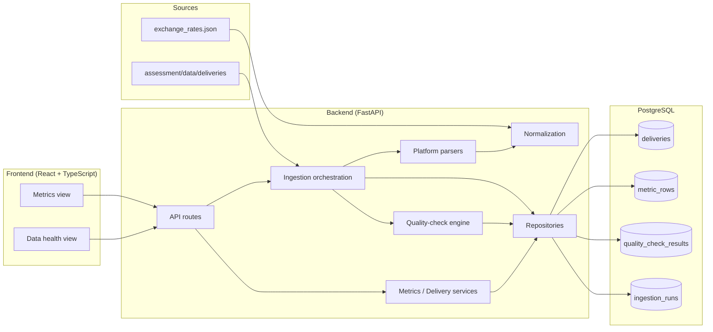

# Campaign Data Hub

Advertising delivery analytics and data quality platform.

This system normalizes Meta, Google, and LinkedIn weekly delivery files into one
canonical metrics dataset, runs extensible quality checks on every delivery, and
exposes both the numbers and their trustworthiness through a FastAPI API and a
React dashboard.

Assessment materials (dataset + brief) live under `assessment/`.

---

## Architecture

Modular monolith: one FastAPI backend, one PostgreSQL database, one React app.



**Data flow:** discover delivery files → parse per platform → normalize to
canonical rows (Decimal USD) → run registered quality checks → upsert delivery +
metrics + findings → serve aggregates and health reports to the UI.

---

## Prerequisites

| Tool | Version |
|---|---|
| Python | 3.12+ |
| Node.js | 20+ |
| Docker Desktop | PostgreSQL 16 via Compose |

---

## Setup and run

Commands assume the repository root unless noted.

### 1. Database

```bash
docker compose up -d db
```

### 2. Backend

```bash
cd backend
python3 -m venv .venv
source .venv/bin/activate   # Windows: .venv\Scripts\activate
pip install -e ".[dev]"
cp .env.example .env
alembic upgrade head
uvicorn app.main:app --reload --port 8000
```

- Health: http://localhost:8000/api/v1/health
- OpenAPI: http://localhost:8000/docs

`ASSESSMENT_DATA_DIR` defaults to `../assessment/data` (must contain
`deliveries/` and `exchange_rates.json`).

### 3. Ingestion

```bash
cd backend
source .venv/bin/activate
python -m app.ingestion.cli --data-dir ../assessment/data
```

Or via API (backend running):

```bash
curl -X POST http://localhost:8000/api/v1/ingestions \
  -H 'Content-Type: application/json' \
  -d '{}'
```

Re-running ingestion is safe: metrics and quality findings are replaced
idempotently for each `(platform, week_start)` delivery.

### 4. Frontend

```bash
cd frontend
cp .env.example .env
npm install
npm run dev
```

App: http://localhost:5173  
`VITE_API_BASE_URL` defaults to `http://localhost:8000`.

### 5. Tests

```bash
cd backend
source .venv/bin/activate
pytest
```

---

## API

| Method | Path | Purpose |
|---|---|---|
| `GET` | `/api/v1/health` | Liveness + DB ping |
| `GET` | `/api/v1/metrics` | Aggregated metrics (`group_by=campaign\|platform`, filters) |
| `GET` | `/api/v1/deliveries` | Deliveries with health classification |
| `GET` | `/api/v1/deliveries/{id}` | Delivery detail |
| `GET` | `/api/v1/deliveries/{id}/quality-report` | Check findings for one delivery |
| `POST` | `/api/v1/ingestions` | Trigger full ingestion |
| `GET` | `/api/v1/ingestions/{id}` | Ingestion run summary |

**Derived metrics:** CTR = clicks / impressions, CPC = spend_usd / clicks.  
When the denominator is zero, the API returns JSON `null` (not `0`).

---

## Normalization

| Platform | Spend → USD | Date |
|---|---|---|
| Meta | `spend` as USD (`Decimal`) | `MM/DD/YYYY` |
| Google | `Cost (micros) / 1e6 × FX[currency]` | `YYYY-MM-DD` |
| LinkedIn | `amount × FX[currency]` | `date_ts` epoch ms → UTC date |

Rules:

- Money math uses `Decimal`; persist `spend_usd` as `NUMERIC(18,6)`.
- Campaign identity: `strip()` only; original value kept as `campaign_raw`.
- Meta week `2026-06-08` magnitude anomaly is **rejected** (no silent ÷100 “fix”).
- `_resend` files map to the same delivery key `(platform, week_start)`.
- Invalid rows are excluded from aggregates and retained in `rejected_rows`.

---

## Quality checks and findings

| check_id | Fail severity | What it found in the provided data |
|---|---|---|
| `missing_expected_delivery` | error | Missing LinkedIn week `2026-06-22` |
| `duplicate_or_resend_file` | warn | Google `*_resend` duplicate file |
| `duplicate_rows` | warn | Duplicate logical keys inside Google `2026-06-01` |
| `schema_required_fields` | error | Missing clicks (Meta / LinkedIn) |
| `date_parse_or_calendar` | error | Invalid / mixed Meta dates |
| `numeric_validity` | error | Negative Meta spend |
| `spend_magnitude_anomaly` | error | Meta `2026-06-08` spend ~100× peers |
| `campaign_name_hygiene` | warn | Case / trailing-space campaign variants |

**Health classification**

- `fail` if any error-severity check failed
- `warn` if only warn-severity checks failed
- `pass` otherwise

**Extensibility:** rejected-reason projections are registered as
`RejectedReasonCheck(...)` instances in `backend/app/quality/registry.py`.
Structural checks are modules under `backend/app/quality/checks/`. Add a check +
test without editing existing check modules.

---

## Design decisions and trade-offs

| Decision | Why | Trade-off |
|---|---|---|
| **PostgreSQL** | UNIQUE constraints + transactions make idempotent re-ingest easy to prove | Needs Docker/local Postgres (heavier than SQLite) |
| **Modular monolith** | Clear module boundaries without microservices overhead | Single deployable; scale later if needed |
| **Decimal / NUMERIC(18,6)** | Avoid float drift on money | Slightly more verbose than float |
| **Reject magnitude anomaly** | Prefer an honest fail over a silent unit “fix” | That week’s spend is excluded until source is corrected |
| **Strip-only campaign identity** | Preserve source truth; hygiene via quality warnings | Case variants remain separate metric keys |
| **Replace findings on re-ingest** | Latest report wins; no duplicate quality rows | Historical per-run finding history not retained |
| **CTR/CPC at read time** | Avoid stale derived columns | Negligible query cost at this scale |

---

## What I would do with more time

1. Browser E2E tests for metrics filters and health drill-down.
2. Dual-writer concurrency controls if multi-operator ingest is required.
3. Optional campaign entity resolution for case/space variants.
4. Async ingestion with run-status polling for larger datasets.
5. Authn/authz around ingest and sensitive reports.
6. Optional full-stack Docker Compose profile (app + UI + DB).
7. Keep historical quality findings per ingestion run.
8. Clear the Starlette TestClient / httpx deprecation warning.

---

## Repository layout

```text
assessment/          # provided dataset + assessment brief
backend/             # FastAPI, Alembic, pytest
frontend/            # React + TypeScript (Vite)
docker-compose.yml   # PostgreSQL 16
```
